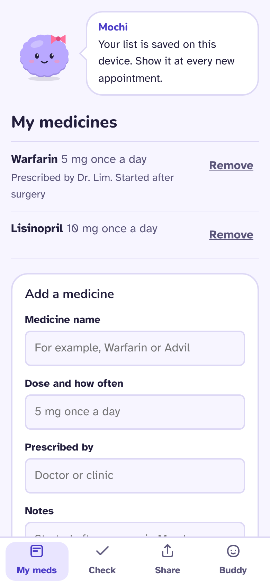
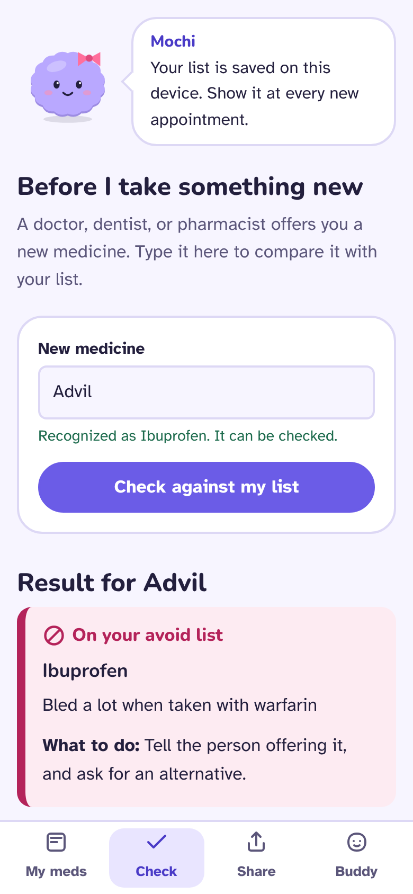
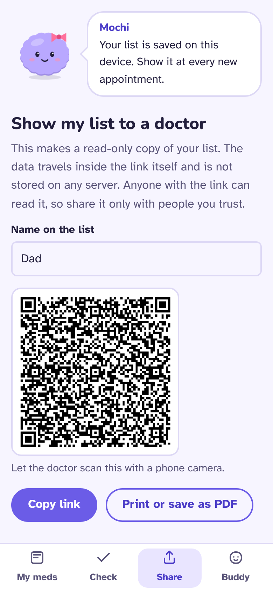
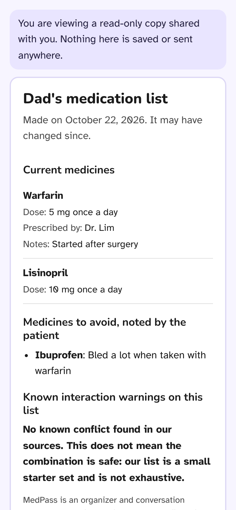
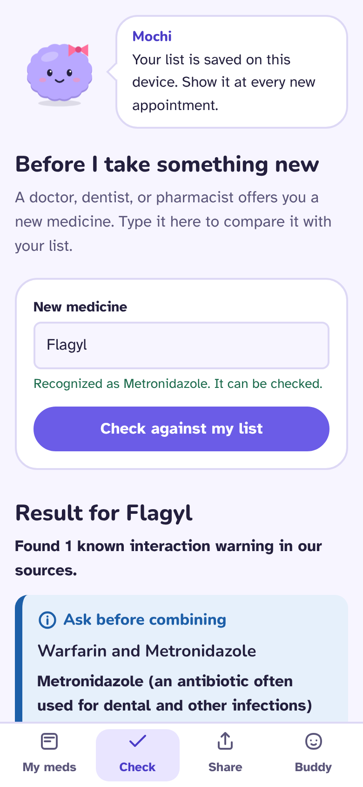
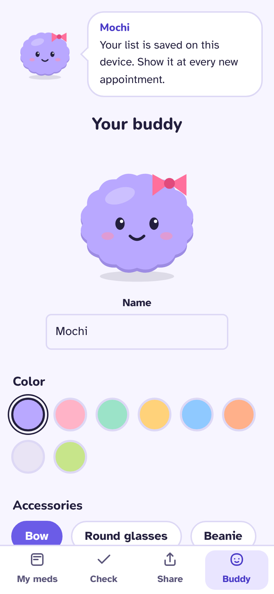
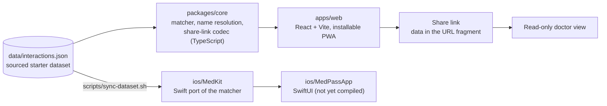

# MedPass

**A patient-held medication passport for the moment care moves between providers.**

When someone changes hospitals, or sees a dentist after surgery, their medication history does not always
follow them. A prescriber who cannot see the full list can prescribe something that conflicts with what the
patient already takes. MedPass puts the patient in charge of one source of truth: they keep their medicines
and the ones to avoid, check any new medicine against that list before taking it, and hand any new doctor a
clear, read-only copy.

MedPass is an organizer and a conversation starter. **It is not medical advice**, and it never says a combination is safe.

<p>
  
  
  
  
</p>

## What it does

- **My meds:** current medicines with dose and prescriber, plus a list of medicines to avoid and why.
- **Before I take something new:** type a new medicine (generic or brand name) and see documented interaction
  warnings against your list, in plain language, each with its FDA label source and section.
- **Show my list to a doctor:** a read-only link, QR code, or printable page. The data lives inside the link
  itself, so it is never stored on a server.
- **A buddy:** a fluffy blob whose color and accessories you choose. It reacts to your list. The data is serious, the companion is gentle.

<p>
  
  
</p>

## How it is built



| Part | Notes |
| --- | --- |
| `packages/core` | All logic, tested with Vitest. Free of UI and storage so both apps can use it. |
| `data/interactions.json` | 16 interaction warnings across 35 drugs and 6 drug classes. Every entry cites a label, section, and retrieval date. |
| `apps/web` | Local-only storage, no accounts, no analytics, no network calls for your data. Works offline after the first load. |
| `ios/` | Swift package and SwiftUI app. Written but not yet compiled. See [`ios/README.md`](ios/README.md). |

## Safety and privacy decisions

These are deliberate and written down in [`docs/safety-and-privacy.md`](docs/safety-and-privacy.md). The short version:

- "No known conflict found in our sources" is the strongest statement the app ever makes, and it always adds that this does not mean the combination is safe.
- A name the app cannot identify is reported as **not checked**. It is never silently treated as fine.
- Typos produce suggestions the user must confirm. The app never guesses a drug and runs a check on the guess.
- Warning wording stays within what the label says. Where a label only says "monitor," the app does not escalate it.
- Medication data stays on the device. A shared link carries the data in the URL fragment, which browsers do not send to servers.
- Shared data is treated as untrusted: it is validated, size-capped, and decompressed with a hard limit.

## Run it

```bash
npm install
npm test          # core unit tests
npm run dev       # web app on http://localhost:5173
npm run build     # typecheck and production build
```

## Tests

- 34 unit tests in `packages/core`: dataset integrity (every reference resolves, every entry is sourced, no alias is ambiguous), name resolution, the matcher including a "new prescription for someone on warfarin" scenario, the share-link codec, and a check that the iOS dataset copy matches the master.
- The full browser flow was exercised end to end in headless Chromium: add medicines, check a new one, create a link, open it in a fresh browser with no saved data, and open a corrupted link.

## Limits you should know about

- The dataset is a **starter set**, not a drug database. It covers well-documented, high-impact combinations only.
- Some sources are older label versions or third-party mirrors of the FDA text. Each is flagged in the data and in the app.
- It only checks pairs. It does not check dose, kidney function, allergies, or conditions.
- Interaction lookups for drugs outside the list are not possible yet. Adding a larger source such as RxNorm for name normalization is the next step.

## Roadmap

- Larger, still-sourced dataset, with RxNorm for name normalization.
- Pill-bottle scanning with on-device text recognition.
- Share link in the iOS app, and a compiled, tested iOS build.
- Optional reminders.
